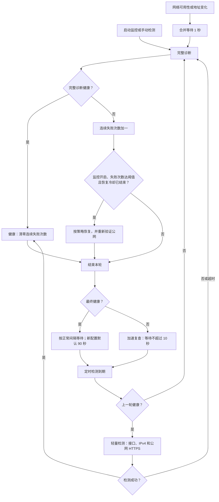

# NetGuardian

面向远程 Windows 实验室电脑的 Wi-Fi 监控与恢复工具。包含 WPF 管理界面和无界面后台守护。Setup 安装版内置 .NET 8 运行时；默认 ZIP 发布版需要另装 .NET 8 桌面运行时，开发、构建才需要 SDK。

## 安装与卸载

安装包发布后可从 [GitHub Releases](https://github.com/stengger/NetGuardian/releases) 下载 `NetGuardian-<版本>-win-x64-Setup.exe`。双击并接受管理员权限提示，选择安装目录，完成后从开始菜单启动 NetGuardian；桌面快捷方式可在安装时选用。支持 Windows 10 1809 及更新的 x64 兼容系统。

安装器不会自动开启后台任务或高风险恢复。需要无人值守时，先保存两个实际可用的 Wi-Fi，再按下文安装后台；从安装目录运行注册脚本时，后台使用同一目录。SYSTEM 后台仅允许从受保护的 Program Files 子目录启动；选择其他目录安装时可使用管理界面，但需移至 Program Files 后才能启用该后台。

升级前先从托盘退出界面，并运行安装目录的 `scripts/unregister-netguardian-task.ps1` 安全停止并移除后台及监督任务。仅停止当前进程不足以避免监督任务再次拉起；安装器发现已有任务时会拒绝覆盖。升级后可按需重新开启后台，已有配置和日志保留。

卸载入口位于 Windows“设置 → 应用 → 已安装的应用”以及开始菜单。先从托盘退出界面；确认卸载后，卸载器核对后台任务归属、请求退出并等待恢复收尾，停止失败则中止卸载。用户及机器数据目录中的配置和日志不随卸载删除。

## 恢复行为

- 按策略检测无线设备、SSID、IPv4、DNS 和多个公网 HTTPS 目标。
- 当前 Wi-Fi 关联正常但校园网上游失效时，尝试重连并验证真实联网；仍失败则按优先级切到另一 Wi-Fi。
- 只有公网验证成功才报告恢复。失败网络有短期退避，整轮恢复有截止时间。
- 网关不响应 Ping 不直接认定断网；HTTPS 不把认证页重定向算作成功。
- 代码 10 等 PnP 无线设备故障独立诊断。高风险恢复明确开启后，才尝试 WLAN 服务、网络接口或 PnP 设备重启。
- 后台恢复动作冷却记录持久化，进程重启不能绕过。整机重启默认关闭，仅可用于持续设备故障，并且最多每 24 小时尝试一次。

两个 Wi-Fi 必须已经保存 Windows 无线配置，且备用网络确实能独立上网。网页或专用客户端的校园认证尚不支持自动登录；同一网卡物理损坏或两个上游同时故障时，软件不能保证恢复。

界面启动和点击“扫描”时会自动读取 Windows 已保存的 Wi-Fi，加入恢复优先级列表并保存到应用配置；无需重新输入或导出密码，也不会因导入而切换网络。当前连接的网络在新导入项中优先，其余新网络排在原列表之后；已有优先级、启用及自动连接选项保留。新导入项默认启用并允许自动连接，可在列表中调整。导入保留历史记录，但恢复优先级列表只显示本次扫描到且 Windows 凭据可用的 Wi-Fi；离开附近的网络只隐藏，不删除配置或优先级，重新扫描到后恢复显示。扫描前、扫描失败或取消后不展示旧扫描结果。列表中的上移、下移按可见网络操作。导入不代表已经验证能上网。手动移除的网络不会再次自动导入，需要时可手动重新添加；临时验证配置不导入。读取失败或超时保留原配置。后台仅同步已有候选的凭据状态，新增 Windows 网络后请启动界面或点击“扫描”导入。

## 检测流程



图中定时循环仅在监控开启时运行；未开启监控时，界面手动检测只读，不自动启用网卡或执行恢复。完整诊断依次检查设备错误码、无线状态、SSID、IPv4、网关、DNS 和公网 HTTPS；策略允许时会先尝试启用被禁用的无线设备。网关 Ping 失败仍继续检测；DNS 至少一个目标成功，HTTPS 单目标必须成功，多目标至少两个成功，且只有 HTTP 2xx 算通过。轻量失败先转完整诊断，不直接触发恢复。

正常间隔读取保存的策略，已有配置保留原值；实际检测周期还包含检测和恢复耗时。完整探测默认上限 30 秒，单轮检测与恢复默认总上限 2 分钟。具体实现见 [MonitoringEngine.cs](src/NetGuardian.Core/Monitoring/MonitoringEngine.cs) 和 [ConnectivityTester.cs](src/NetGuardian.Core/Connectivity/ConnectivityTester.cs)。

## 构建、测试和发布

如果 SDK 不在 PATH，先设置环境变量（不修改系统 PATH）：

```powershell
$env:NETGUARDIAN_DOTNET = '你的 dotnet.exe 完整路径'
.\scripts\build.ps1
& $env:NETGUARDIAN_DOTNET test tests\NetGuardian.Tests\NetGuardian.Tests.csproj
.\tests\Test-GuardianScripts.ps1
.\scripts\publish.ps1
```

显式 SDK 路径用户也可用 `& $env:NETGUARDIAN_DOTNET test ...`。发布脚本先还原、测试，再输出：

```text
dist\NetGuardian\NetGuardian.exe                    管理界面
dist\NetGuardian\guardian\NetGuardian.Guardian.exe  后台守护
```

直接运行发布界面，或使用 `Start-NetGuardian.vbs`。启动正式版不再要求 SDK；启动脚本不会重定向 APPDATA。退出界面时等待正在执行的网络恢复收尾。

### 构建 Setup 安装包

开发机另需 [Inno Setup 7](https://jrsoftware.org/isdl.php)。设置 SDK 和编译器路径后执行（版本号按实际发布版本填写）：

```powershell
$env:NETGUARDIAN_DOTNET = '你的 dotnet.exe 完整路径'
$env:NETGUARDIAN_ISCC = '你的 Inno Setup 7\ISCC.exe 完整路径'
.\scripts\build-installer.ps1 -Version 1.1.0
```

脚本先运行 Release 完整测试，再将管理界面和 Guardian 以 `win-x64` 自包含模式发布到新的暂存目录，加入 README、启动入口与后台维护脚本，最后编译：

```text
dist\releases\NetGuardian-1.1.0-win-x64-Setup.exe
dist\releases\NetGuardian-1.1.0-win-x64-Setup.exe.sha256
```

将这两个文件上传为 GitHub Release 附件；GitHub 自动生成的源码 ZIP 不能替代安装包。安装包默认未做代码签名，公开分发时可另配置发行者证书签名。构建安装包不会在开发机安装、切网或启动后台。

## 应用内更新

从 v1.1.0 起，在“设置 → 软件更新”手动检查正式版本，查看发布说明并下载。安装包通过 SHA256 校验后，才能选择“安装并重启”；检查和下载期间可取消。更新使用公开 GitHub Releases，无需登录，连接遵循 Windows 系统代理。

确认安装后，程序先备份，再正常退出界面、安全停止本安装目录的后台与监督任务，安装后恢复原任务状态并重新打开界面。配置和日志保留；失败时尝试恢复旧程序，恢复失败则记录原因并停止启动。更新记录和备份位于 `%ProgramData%\NetGuardian\updates`，设置页显示上次更新结果及日志位置。请保留这些记录供排查。

只有 Program Files 下的正式安装支持原地更新；开发目录可检查和下载。v1.0.x 需先手动安装一次 v1.1.0，之后可通过应用内更新升级。

## 安装无人值守后台

1. 在界面保存两个 Wi-Fi，配置优先级、探针和恢复策略。高风险恢复按需显式开启。
2. 管理员 PowerShell 先检查安装内容：

```powershell
.\scripts\register-netguardian-task.ps1 -WhatIf
```

3. 在具备本地回退方式的维护窗口安装：

```powershell
.\scripts\register-netguardian-task.ps1 -RunNow
```

安装程序将发布文件复制到 `%ProgramFiles%\NetGuardian`，首次将用户配置复制到 `%ProgramData%\NetGuardian\settings.json` 并限制写权限；后续默认保留已有机器配置。注册 SYSTEM 开机任务和每分钟监督任务。无需自动登录，也不依赖交互桌面。主任务跟踪真实 Guardian 进程，异常退出会重试；心跳过期会核对任务执行目标和本次启动时间后重新启动。

`-RunNow` 会立即开始监控；不加此参数时，监督任务也会在约一分钟内启动后台。安装后可能按既有策略切换网络，远程会话可能中断。注册安装完成不等于真实无人值守验收通过。

安装后重新打开界面，自动使用机器配置。后台每五秒热加载有效配置，每分钟与当前身份能读取的 Windows 无线配置同步凭据可用状态，避免旧界面标记排除已保存的备用网络；Windows 配置查询失败时保留最近有效状态。手动连接 Wi-Fi、设置凭据、修改 DNS、续租 DHCP 及网络维护会自动等待后台恢复收尾并临时接管，完成后恢复守护，无需停止后台任务。交接期间显示等待和操作状态，跨窗口操作保持独占；操作后给网络 30 秒稳定时间。需要同时更新界面与后台组件，旧后台会提示升级，不执行未取得控制权的网络修改。顶部开始/停止仍仅控制界面监控，后台交接时页头及托盘显示暂停状态。

从恢复列表或周围网络中选中已添加且凭据可用的 Wi-Fi，可点击“连接”。界面会等待真实关联和联网检测，分别报告连接成功、已连接但公网不可用、连接未确认；不会将“命令已发送”作为成功。扫描前同步已保存配置也包含在进度和取消流程内。详见[体验流程检查](docs/2026-11-09-workflow-experience-review.md)。

监控采用网络事件与自适应定时检测结合：启动及手动检测执行完整诊断；健康期间读取接口快照并发送配置的 HTTPS HEAD 探针，省去系统命令、网关 Ping 和独立 DNS 探针。新配置正常间隔默认 90 秒，已有配置保留原值，可在恢复策略页调整。轻量探测失败后立即完整诊断，异常时每轮结束后等待不超过 10 秒复核，恢复正常后返回正常间隔；实际周期还包含检测和恢复耗时。

网络可用性或地址变化后合并等待 1 秒触发完整诊断，检查中收到的变化最多追加一次；事件订阅失败时保留定时兜底并记录原因。失败次数仍以完整诊断为准，恢复阈值、冷却及控制锁保持生效。首页和日志区分轻量检测与完整诊断，探针列表只展示本轮结果；轻量检查不查询 SSID，因此该轮网络名称可能显示为空。此方案减少正常期间的重复工作，具体 CPU、内存和流量变化须现场测量。

安装前后可使用只读诊断，检查当前身份、可用无线配置和实际公网探针；此命令不会自动启用网卡或切网：

```powershell
.\dist\NetGuardian\guardian\NetGuardian.Guardian.exe --diagnose --settings '<完整配置路径>' --output '<诊断输出路径>'
```

健康、Windows 配置可读取且至少两个启用的自动连接候选实际可用时返回 0，否则返回 2；输出不包含无线密码。`--validate` 仅检查磁盘配置，不依据可能过时的凭据标记判断 Windows 中的实际可用性。

需要定位后台扫描差异时，在 `--diagnose` 后加 `--scan`，额外输出原生扫描错误码、原生及 netsh 可见网络；不会执行连接或恢复动作。

无线接口被禁用后，即使 WLAN 接口暂时消失，后台也会检查仍存在的 PnP 无线设备。设备代码 22 使用精确实例执行启用；代码 10 等启动故障继续走分级设备恢复，不能当作普通接口禁用处理。

更新前请先停止旧后台；卸载先停止监督，再请求后台退出并等待恢复收尾，保留程序、配置和日志：

```powershell
.\scripts\unregister-netguardian-task.ps1
```

机器配置存在时，界面仍使用它；取消后台后可手动启动界面监控。

## 可选整机重启

只针对长时间持续的无线设备故障，不针对普通上游断网。需在共享 settings.json 显式设置：

```json
{
  "enableComputerRestart": true,
  "deviceFailureMinutesBeforeRestart": 30
}
```

以上是已有配置的字段示例，不能拿它替换完整配置。默认关闭，最短设备故障等待十分钟。还需启用高风险恢复及服务、网卡恢复策略：同一次持续设备故障中，两种恢复必须实际尝试过，冷却跳过或取消不算；恢复正常或转为上游故障时清除计时和动作记录。重启前重新检查设备错误码，并限制每二十四小时最多一次，恢复记录损坏或不可写时禁止此动作。

预留预算后会发出六十秒倒计时重启，Windows 可能强制关闭应用；取消倒计时使用管理员命令 `shutdown /a`。实验任务、磁盘加密和远程软件的开机行为必须在启用前确认。

## 配置与日志

- 未安装后台：`%APPDATA%\NetGuardian`。
- 安装后台后：`%ProgramData%\NetGuardian`，界面与后台共用。
- `settings.json` / `.bak`：配置和备份，不保存明文无线密码。
- `logs\app-YYYYMMDD.log`：按天记录；`events-YYYYMM.jsonl`：恢复事件。
- `guardian-status.json`：进程身份、心跳及最近检测结果。
- `recovery-budget.json`：跨进程恢复冷却；`alerts\last-high-risk.json`：最近高风险动作。

## 项目目录

```text
src/NetGuardian.Core      检测、恢复状态机、无线 API、配置和日志
src/NetGuardian.App       WPF 管理界面
src/NetGuardian.Guardian  不依赖登录的后台进程
tests                    xUnit 场景测试与无破坏脚本测试
scripts                  构建、发布、安装、卸载和心跳监督
docs                     本轮计划、验证记录；archive 保存历史设计与审查
```

历史报告不是当前功能清单。没有真实故障验收前，不应把模拟测试通过等同于无人值守可靠性已得到现场确认。

本机 2026 年 10 月现场验收已覆盖：仍关联但上游失效时切换另一独立 Wi-Fi、禁用设备自动启用、精确 PnP 重启、守护崩溃后监督重拉，以及重启后未登录时 SYSTEM 后台自行恢复公网。原始 Code 10 故障未再次复现，不能将上述结果称为该原始故障已实测修复；设备故障自动重启的判定和预算已有分模块测试，完整 Code 10 组合模拟仍可补充。见[实施计划与完成审计](docs/2026-10-18-unattended-recovery-plan.md)。
