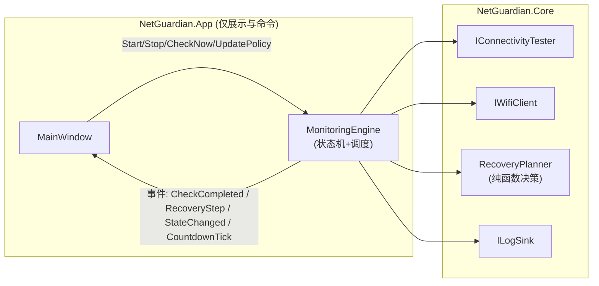

# NetGuardian 后续优化设计方案

- 日期：2026-07-07
- 依据：`OVERVIEW.md` 三视角分析 + 决策确认
- 已确认决策：
  1. 根目录 `netguardian/`（Python）为**废弃原型**，连同相关遗留物一并清理；
  2. **采纳抽取 MonitoringEngine 的架构路线**，覆盖 `docs/superpowers/` 原"仅窄范围提取、不做重构"的决策；
  3. 高风险恢复动作（重启 WLAN 服务/网卡）**将以"显式开关 + 告警"形式启用**。

---

## 0. 总体原则

- **行为兼容**：现有功能、`settings.json` 配置格式向后兼容（只增不改语义；新字段有安全默认值）。
- **渐进重构**：每个阶段结束时应用可构建、可运行、测试全绿，可独立合入。
- **非破坏优先不变**：高风险动作即使启用，也永远排在分级恢复链的最后，且默认关闭。
- **UI 不大改版**：本方案不调整页面信息架构，仅在必要处新增控件（高风险开关、日志导出等）。

## 1. 阶段划分

| 阶段 | 主题 | 依赖 | 预估规模 |
|------|------|------|----------|
| M1 | 仓库清理 + 测试框架迁移 | 无 | 小 |
| M2 | 核心重构：MonitoringEngine 抽取 + DI | M1 | 大（本方案核心） |
| M3 | 可观测性：文件日志 + 事件持久化 | M2 | 中 |
| M4 | 高风险恢复动作启用（开关 + 告警） | M2、M3 | 中 |
| M5 | 体验补齐：Profile 即时验证、确认框、引导、配置化探测目标 | M2 | 中 |

各阶段验收标准见 §7。

## 2. M1 仓库清理与测试框架迁移

### 2.1 清理清单（删除）

- `netguardian/`（含 `__pycache__`）、根目录 `__pycache__/run.cpython-312.pyc`、`tests/__pycache__/`
- `scripts/rebuild_xaml.py`、`scripts/rewrite_xaml.py`（一次性 XAML 改写脚本）
- `scripts/query_symbols.csproj`、`scripts/Program.cs`、`scripts/bin/`、`scripts/obj/`、`scripts/CheckWpfUi/`
- `.gitignore` 补充：`__pycache__/`、`.dotnet-home/`、`dist/`、`scripts/bin|obj`

### 2.2 构建脚本去硬编码

`scripts/build.ps1` / `resolve-dotnet.ps1` 中的回落路径 `E:\Environment\dotnet-sdk-8.0` 改为：环境变量 `NETGUARDIAN_DOTNET` → PATH 中的 dotnet → 报错提示。README 同步更新。

### 2.3 测试迁移到 xUnit

- `tests/NetGuardian.Tests` 改为 xUnit 类库（`Microsoft.NET.Test.Sdk` + `xunit` + `xunit.runner.visualstudio`）。
- 现有 14 个用例逐一平移为 `[Fact]`/`[Theory]`（netsh 解析类用 `[Theory]` 参数化中英文样本）。
- 保留 `dotnet test` 作为唯一测试入口；README 更新命令。

## 3. M2 核心重构：MonitoringEngine（本方案核心）

### 3.1 目标形态

把目前寄生在 `MainWindow.xaml.cs` 中的"定时检查 → 失败计数 → 冷却判断 → 分级恢复"状态机整体下沉到 Core，成为**与 UI、与 WPF Dispatcher 完全无关**的可单测组件。MainWindow 退化为：订阅引擎事件刷新 UI + 把按钮点击转发为引擎命令。



### 3.2 新增/修改类型

**新增 `Core/Monitoring/`：**

```csharp
// 纯决策，无 I/O，最易测试
sealed class RecoveryPlanner
{
    // 输入当前状态，输出下一个恢复动作（枚举），不执行
    RecoveryAction PlanNext(RecoveryContext ctx);
}

enum RecoveryAction
{
    None, FlushDns, SoftReconnectCurrent,
    SwitchToNextProfile,
    RestartWlanService,   // 高风险，M4 启用
    RestartAdapter,       // 高风险，M4 启用
    GiveUp
}

sealed class MonitoringEngine : IAsyncDisposable
{
    // 依赖全部走接口注入
    MonitoringEngine(IConnectivityTester tester, IWifiClient wifi,
                     RecoveryPlanner planner, ILogSink log,
                     TimeProvider time);          // TimeProvider 便于测试虚拟时钟

    void Start(); void Stop();
    Task CheckNowAsync(CancellationToken ct);
    void UpdatePolicy(MonitorPolicy policy);
    void UpdateProfiles(IReadOnlyList<WifiProfile> profiles);

    // 事件（在线程池线程触发，UI 自行调度）
    event EventHandler<CheckCompletedEventArgs> CheckCompleted;
    event EventHandler<RecoveryStepEventArgs>  RecoveryStepExecuted;
    event EventHandler<EngineStateChangedEventArgs> StateChanged;
    event EventHandler<TimeSpan> CountdownTick;
}
```

**接口化现有服务**（签名不变，仅提取接口）：`IConnectivityTester`、`ISettingsStore`、`INetworkConfigurationService`、`ISpeedTestService`、`IWebsiteTestService`、`IPublicIpInfoService`、`ILogSink`（M3 实现文件版，M2 先用内存版适配现有环形缓冲）。

### 3.3 关键设计决策

- **调度用 `PeriodicTimer` + `TimeProvider`**（.NET 8 内置），替代 3 个 `DispatcherTimer` 中与 UI 无关的 2 个（监控、倒计时逻辑）；`_sidebarSpeedTimer` 属纯 UI，留在窗口。虚拟时钟使"冷却期、间隔"可在毫秒级单测。
- **RecoveryPlanner 与执行分离**：决策是纯函数（给定失败次数、冷却状态、Profile 列表、上次动作 → 下一动作），执行由 Engine 完成。单测集中打决策，不需要 mock 网络。
- **并发控制内聚**：现有 `_checkLock` 信号量移入 Engine；`CheckNowAsync` 与定时检查共用同一互斥。
- **事件线程契约**：Engine 事件不保证 UI 线程；MainWindow 统一经 `Dispatcher.BeginInvoke` 处理，消除现有散落的调度调用。
- **UI 同步标志位治理**：`_isSyncingDnsControls` 等改为 `IDisposable` guard（`using var _ = _dnsSync.Enter();`），异常路径自动复位。

### 3.4 DI 引入

- `NetGuardian.App` 引入 `Microsoft.Extensions.DependencyInjection`（仅此一包，不引 Hosting）。
- `App.xaml.cs` 中组装容器：所有 Core 服务注册为单例，`MainWindow` 构造注入。
- 不做配置系统替换（`SettingsStore` 保持现状，仅接口化）。

### 3.5 迁移步骤（可分 PR）

1. 服务接口化 + DI 容器接入（MainWindow 行为零变化）；
2. 抽 `RecoveryPlanner` 纯决策 + 单测（对照现有 MainWindow 分支逐条平移）；
3. 抽 `MonitoringEngine`，MainWindow 改为事件订阅；删除窗口内对应字段/方法（预计 MainWindow.xaml.cs 缩减 800–1200 行）；
4. 回归：手动冒烟（扫描/监控/断网模拟/托盘/自启）+ 全部单测。

### 3.6 M2 新增测试（xUnit）

- RecoveryPlanner：阈值未达/已达、冷却期内/外、Profile 全禁用、切换轮转顺序、DNS 刷新开关组合（Theory 覆盖矩阵）。
- MonitoringEngine（用 FakeTester/FakeWifi + 虚拟时钟）：定时触发、CheckNow 与定时互斥、Stop 后不再触发、策略热更新生效。

## 4. M3 可观测性

### 4.1 文件运行日志

- 新增 `Core/Logging/FileLogSink : ILogSink`：写入 `%APPDATA%\NetGuardian\logs\app-yyyyMMdd.log`，按天滚动，默认保留 14 天（`AppSettings.LogRetentionDays`，钳制 1–90）。
- 写入策略：后台 Channel 队列 + 单写线程，避免 UI/引擎阻塞；进程退出 flush。
- 现有内存 500 行环形缓冲保留（供 UI 日志页），`CompositeLogSink` 同时写两路。
- UI：日志页新增"导出日志"按钮（复制当日/全部日志到用户选择目录）。

### 4.2 事件持久化与统计

- 新增 `events.jsonl`（每行一条：时间、类型 check/recovery、状态、动作、结果、耗时），与日志同目录，按月滚动。选 JSONL 而非 SQLite：零依赖、可直接文本查看，数据量小（每 30s 一条 ≈ 2880 条/天，仅失败与恢复事件全量记录，健康检查按小时聚合采样）。
- 状态页 hero 卡下新增摘要行："近 7 天：断网 N 次 / 自动恢复成功 M 次（成功率 x%）"，启动时异步扫描 jsonl 汇总。
- 双语键补充进 `Localizer`（沿用现有键一致性测试保障）。

## 5. M4 高风险恢复动作（显式开关 + 告警）

### 5.1 行为设计

- `MonitorPolicy` 新增：

```csharp
bool EnableHighRiskRecovery { get; set; } = false;   // 默认关闭
int  HighRiskAfterFailedSwitches { get; set; } = 2;   // 完整走完低风险链 N 轮后才允许
int  HighRiskCooldownMinutes { get; set; } = 30;      // 独立长冷却
```

- RecoveryPlanner 扩展决策链：`...SwitchToNextProfile` 全轮失败 ≥ N 次 → `RestartWlanService` → 仍失败 → `RestartAdapter` → `GiveUp`。两个高风险动作各自受独立冷却限制，且**每个恢复周期最多执行一次**。
- 执行实现放 `Core/Recovery/HighRiskRecoveryService`：`net stop/start WlanSvc`、`netsh interface set interface ... disable/enable`（复用 NetworkConfigurationService 的命令执行基建），执行前后各做一次快速连通性探测并记录对比。

### 5.2 UI 与告警

- 策略页新增"高风险恢复"分组：主开关 + 两个参数，开关默认灰显文案说明风险；**开启时弹确认对话框**（双语），说明可能导致远程会话瞬断。
- 每次执行高风险动作：
  - 事件日志 + `events.jsonl` 记录为 `severity: high`；
  - 托盘气泡通知（本机可见）；
  - **写告警文件** `%APPDATA%\NetGuardian\alerts\last-high-risk.json`（时间、动作、前后探测结果），供远程运维脚本轮询——作为 M4 的最小"远程告警"形态；webhook/邮件通知列为后续可选项，不在本期范围。

### 5.3 测试

- Planner 层：未启用时永不产出高风险动作；启用后仅在满足"低风险链失败 N 轮 + 冷却外"时产出；单周期不重复。
- Service 层：命令拼装单测（不真执行）。

## 6. M5 体验补齐

1. **Profile 添加后即时验证**：AddWifiDialog 保存成功后，Engine 执行一次"连接该 SSID → 快速探测 → 恢复原连接"（复用现有 WifiValidationTimeout/WifiRestoreTimeout），结果以对话框 + 事件日志反馈"密码可能错误/验证通过"。
2. **破坏性操作确认**：删除优先级 Profile、注销计划任务前弹确认框（双语）。
3. **扫描进度指示**：扫描按钮期间置 loading（WPF-UI ProgressRing）+ 按钮禁用。
4. **探测目标配置化**：`MonitorPolicy` 新增 `DnsProbeHosts`、`HttpsProbeUrls`、速测/IP 服务端点，默认值即现硬编码值；策略页"高级"折叠区可编辑，`Normalize()` 校验条目数 1–5、URL 合法性。
5. **首启引导**：首次运行（无 settings.json）时状态页显示三步引导卡片（加 Wi-Fi → 调策略 → 开监控），任一步完成后消失。
6. 浅色主题、Localizer 迁移 resx：**列为 backlog，本方案不含**。

## 7. 验收标准与风险

| 阶段 | 验收 |
|------|------|
| M1 | 仓库无 Python/一次性脚本遗留；`dotnet test` 全绿；任意机器无 E 盘路径可构建 |
| M2 | MainWindow.xaml.cs < 2,000 行；监控/恢复逻辑 0 行留在 App；新增单测 ≥ 20 个；手动冒烟通过 |
| M3 | 断网一天后可通过日志文件完整还原时间线；状态页显示 7 天统计 |
| M4 | 默认关闭时行为与 M3 完全一致；开启后可在模拟场景观察到分级执行与告警文件生成 |
| M5 | 错误密码的 Profile 在添加当场即被提示 |

**主要风险与对策：**

- *M2 平移遗漏行为细节*（MainWindow 分支多）：平移前先为现有行为写"表征测试"（针对 RecoveryPlanner 决策表），逐条对照原代码分支；重构 PR 保持小步。
- *高风险动作在远程机上造成失联*：三重保险——默认关闭、低风险链 N 轮失败前置条件、独立长冷却；且执行前写告警文件（即使恢复失败，痕迹已落盘）。
- *jsonl 无限增长*：按月滚动 + 与日志共用保留天数清理。

## 8. 建议实施顺序与产出

M1（1 个 PR）→ M2（3–4 个 PR，核心）→ M3（1–2 个 PR）→ M4（1–2 个 PR）→ M5（按条目独立 PR）。每阶段合入后更新 `README.md` 与本文档状态标记。

---

## 实施进度

- **M1 已完成（2026-07-07）**：清理遗留物；`NETGUARDIAN_DOTNET` 环境变量替代硬编码 SDK 路径；测试迁移 xUnit。
- **M2 已完成（2026-07-07）**：新增 `Core/Monitoring/`（`MonitoringEngine`、`RecoveryPlanner`、引擎事件）、`IConnectivityTester`、`ISystemCommandRunner`/`ProcessCommandRunner`；App 引入 `Microsoft.Extensions.DependencyInjection`，`App.xaml.cs` 组装容器并显式创建 MainWindow（移除 StartupUri）；MainWindow 的监控/恢复逻辑全部下沉至引擎，改为事件订阅 + 命令转发；测试 45 个全绿（含 RecoveryPlanner 决策矩阵与引擎行为测试）。
- M3（文件日志 + 事件持久化）：未开始。
- **M3 已完成（2026-07-07）**：`Core/Logging/FileLogSink`（按天滚动、后台 Channel 写入、保留天数 1–90 钳制、`AppSettings.LogRetentionDays`）；`Core/Logging/EventJournal`（events-yyyyMM.jsonl，失败全量+健康采样记录，7 天汇总：断网次数/恢复尝试/恢复成功）；MainWindow 日志双写文件、状态页新增近 7 天统计行（WeeklySummaryText）、日志页新增"导出日志"按钮（FolderBrowserDialog，导出 app-*.log / events-*.jsonl / crash.log）；双语键补齐（键一致性测试保障）；测试 52 个全绿。
- M4（高风险恢复：开关+告警）：未开始。
- **M4 已完成（2026-07-07）**：`MonitorPolicy` 新增 `EnableHighRiskRecovery`（默认关）/`HighRiskAfterFailedRounds`（1–10，默认 2）/`HighRiskCooldownMinutes`（5–1440，默认 30）；`RecoveryPlanner.EvaluateHighRisk` 纯决策；`Core/Recovery/HighRiskRecoveryService`（net stop/start WlanSvc → netsh 网卡禁用/启用，WLAN 服务恢复成功则跳过网卡重启）；引擎在低风险链整轮失败后计轮数并按决策执行，动作前后探测对比、恢复成功即重置计数；`HighRiskAlertWriter` 落盘 `%APPDATA%\NetGuardian\alerts\last-high-risk.json`；journal 记 severity:high；策略页新增开关（启用时弹双语确认框）+ 托盘气泡通知。测试 66 个全绿。
- M5（体验补齐）：未开始。
- **M5 已完成（2026-07-07）**：①Profile 即时验证——勘察确认现有 `ValidateAndSaveWifiProfileAsync` 已完整实现（确认框+临时 Profile 连接验证+恢复原连接），无需改动；②确认框、③扫描 ProgressRing——**并入 UI 线 U3 执行（见 docs/2026-07-07-ui-optimization-plan.md §8），本线不实现**；④探测目标配置化——`MonitorPolicy.DnsProbeHosts/HttpsProbeHosts`（默认值即原硬编码，Normalize 去重/校验主机名/上限 5/空回退默认），`ConnectivityTester` 改用策略列表，策略页新增两个逗号分隔编辑框；⑤首启引导——无 settings.json 首次运行时状态页 hero 卡显示三步引导，添加 Profile 且开始监控后自动消失。测试 69 个全绿。

**五阶段全部完成。** 后续工作转入 UI 优化线（U1–U5）与 backlog（浅色主题、resx 迁移、webhook 告警）。
