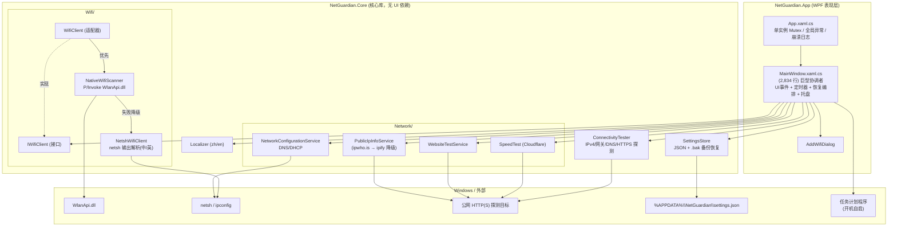
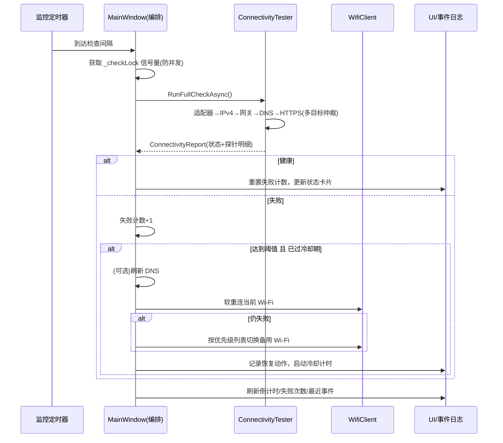
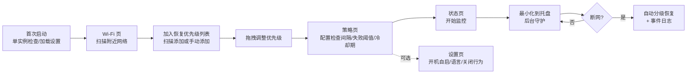

# NetGuardian 项目总览（OVERVIEW）

> 本文档基于对整个代码仓库的通读分析（忽略 `node_modules`、`.dotnet-home`、`dist`、`bin/obj`、`__pycache__` 等生成物），从**软件架构师**、**开发者**、**产品经理**三个视角进行剖析，旨在帮助新人快速上手，并为后续开发提供可执行的改进建议。分析过程未修改任何代码。

---

## 1. 项目是什么

**NetGuardian** 是一款面向 Windows 远程/无人值守机器的 **Wi-Fi 连通性监控与自动恢复工具**（WPF 桌面应用，默认中文界面，支持中英双语）。核心价值：机器断网后无需人工介入，按照"**非破坏性优先**"的分级策略自动恢复网络。

主要功能：

- 周期性连通性体检：Wi-Fi 适配器状态 → IPv4 → 默认网关 → DNS 解析 → 公网 HTTPS 探测（多目标仲裁）
- 自动恢复：连续失败达到阈值后，先刷新/软重连当前 Wi-Fi，再按**可拖拽排序的优先级列表**切换备用 Wi-Fi；高风险动作（重启 WLAN 服务/网卡）默认禁用
- 网络工具箱：DNS 管理（刷新/静态/DHCP）、Cloudflare 测速、网站可达性测试、公网 IP 归属查询、适配器信息
- 系统托盘常驻、开机自启（Windows 计划任务）、事件日志（内存环形缓冲 500 条）
- Wi-Fi 密码通过 Windows 原生 WLAN Profile 保存，**不落明文**

## 2. 仓库结构速览

```
Net/
├── NetGuardian.sln
├── README.md                      # 中文说明（84 行）
├── Start-NetGuardian.vbs          # 无窗口启动器 → scripts/start-netguardian.ps1
├── src/
│   ├── NetGuardian.Core/          # 核心库（~5,474 行，net8.0，无 UI 依赖）
│   │   ├── Models/                # MonitorPolicy / AppSettings / WifiProfile / NetworkState / ConnectivityReport ...
│   │   ├── Wifi/                  # IWifiClient + WifiClient（适配器模式）+ NativeWifiScanner(P/Invoke) + NetshWifiClient
│   │   ├── Connectivity/          # ConnectivityTester：全链路健康检查
│   │   ├── Network/               # 测速 / 网站测试 / 公网IP / DNS配置服务
│   │   ├── Localization/          # Localizer：zh-CN & en-US 硬编码资源字典（~130 键）
│   │   └── Settings/              # SettingsStore：JSON 持久化到 %APPDATA%\NetGuardian\settings.json（含 .bak 备份恢复）
│   └── NetGuardian.App/           # WPF 前端（~3,119 行，net8.0-windows）
│       ├── MainWindow.xaml(.cs)   # ⭐ 2,834 行代码 + 2,600+ 行 XAML 的巨型主窗口
│       ├── AddWifiDialog.cs       # 纯代码构建的添加 Wi-Fi 对话框
│       └── App.xaml.cs            # 单实例互斥锁 + 全局异常捕获 + 崩溃日志
├── tests/NetGuardian.Tests/       # 自研轻量控制台测试框架，14 个用例（356 行）
├── scripts/                       # build/publish/计划任务注册注销（PowerShell）+ 一次性 XAML 改写脚本（Python，疑似遗留）
├── docs/superpowers/              # 优化计划与设计文档
└── netguardian/                   # ⚠️ 空的 Python 包目录（仅 __pycache__，无源码，疑似遗留）
```

技术栈：C# / .NET 8、WPF + WPF-UI 4.3.0（唯一外部 NuGet 依赖）、P/Invoke（WlanApi.dll）、netsh/ipconfig 命令行、PowerShell 部署脚本。

## 3. 系统架构（架构师视角）

### 3.1 架构图



### 3.2 架构评价

**做得好的：**

- **App / Core 两层分离清晰**：Core 无 UI 依赖，模型、Wi-Fi 操作、连通性检测、网络工具、本地化、设置存储职责划分合理，理论上可被 CLI/服务进程复用。
- **适配器 + 降级模式贯穿始终**：Wi-Fi 扫描优先原生 API、失败降级 netsh；公网 IP 查询 ipwho.is 失败降级 ipify；设置文件损坏时从 `.bak` 恢复。对一个"网络不稳时才有用"的工具来说，这种韧性设计恰如其分。
- **恢复策略分级、非破坏性优先**，高风险动作默认禁用，符合远程运维场景的安全诉求。
- **策略参数统一 `Normalize()` 钳制**，配置越界不会导致危险行为。

**主要架构风险：**

1. **`MainWindow.xaml.cs` 是事实上的"上帝对象"**（2,834 行、117 个方法）：UI 事件、3 个后台定时器、恢复编排、托盘、拖拽、计划任务注册全部混在 code-behind。这是可扩展性和可测试性的最大瓶颈——**监控/恢复的核心状态机完全无法脱离 UI 测试**。
2. **无依赖注入**：MainWindow 构造函数直接 `new` 所有服务，Core 中除 `IWifiClient` 外服务均无接口（`SettingsStore`、`ConnectivityTester` 等），替换与 mock 困难。
3. **监控引擎与窗口生命周期绑定**：监控逻辑寄生在 WPF 窗口上，若未来要做"无 UI 后台服务 + 前端仅展示"的形态（远程无人值守场景的自然演进方向），需先把编排逻辑抽出。
4. **探测目标硬编码**（microsoft.com / baidu.com / Cloudflare / ipwho.is），无法按地域/内网环境配置。
5. **可观测性不足**：仅内存 500 行环形日志 + 崩溃日志，正常运行期无持久化 trace，远程排障能力弱——这与产品定位（远程机器）存在矛盾。

## 4. 主要工作流程

### 4.1 监控与自动恢复主循环



### 4.2 用户核心使用流程



### 4.3 构建与部署

`scripts/build.ps1`（Debug 构建，SDK 自动解析并回落到硬编码路径 `E:\Environment\dotnet-sdk-8.0`）→ `scripts/publish.ps1`（发布到 `dist\NetGuardian\`，非自包含）→ `register-netguardian-task.ps1` 注册登录触发的计划任务，动作为 `wscript.exe Start-NetGuardian.vbs`（优先启动已发布 exe，回落 Debug 产物）。测试用 `dotnet run` 跑 `tests/NetGuardian.Tests`。

## 5. 开发者视角

### 5.1 代码质量亮点

- 现代 C#（record、sealed、async/await + CancellationToken 全覆盖），netsh 输出解析同时兼容中英文系统。
- `SettingsStore` 线程安全（锁）、写入前备份、损坏自恢复、空白 Profile 自动清理，是 Core 中工程质量最好的模块之一。
- `App.xaml.cs` 三路全局异常捕获（Dispatcher / TaskScheduler / AppDomain）+ 崩溃日志，托底完善。
- 测试虽少（14 个）但打得准：netsh 解析、WLAN Profile XML 转义、设置往返/备份恢复、策略钳制、**中英资源键一致性校验**——最后这个用例能有效防止漏翻译。
- 无 TODO/FIXME 遗留，代码整体整洁。

### 5.2 主要可维护性问题

| # | 问题 | 位置 | 影响 |
|---|------|------|------|
| 1 | 巨型 code-behind，无 MVVM/ViewModel | `MainWindow.xaml.cs`（2,834 行） | 核心逻辑不可单测，改动影响面难评估 |
| 2 | 无 DI、服务无接口（除 IWifiClient） | App 构造函数直接 new | mock/替换困难 |
| 3 | 自研测试框架，非 xUnit/NUnit | `tests/Program.cs` | 无 IDE 集成、无参数化、CI 报告能力弱 |
| 4 | UI 同步用布尔标志位（`_isSyncingDnsControls` 等） | MainWindow | 异常路径下标志可能"卡死"，脆弱 |
| 5 | 大量硬编码：探测目标、超时（5–20s）、SDK 回落路径 | Core/Network、scripts | 换环境即失效 |
| 6 | 遗留死代码：`scripts/rebuild_xaml.py`、`rewrite_xaml.py`、`query_symbols.csproj`+`Program.cs`、空的 `netguardian/` Python 目录 | scripts/、根目录 | 误导新人，README 未提及 |
| 7 | 日志仅内存 500 行，无文件级运行日志 | MainWindow | 远程排障几乎不可能 |
| 8 | `Localizer` 630 行硬编码字典 | Core/Localization | 加语言/键需改代码，宜换 resx 或 JSON 资源 |

### 5.3 新人上手路径建议

1. 先读 `README.md` 与 `docs/superpowers/` 下的优化设计文档；
2. 从 `NetGuardian.Core/Models/` 读起（很小，~90 行），建立领域概念（Policy / Profile / NetworkState / Report）；
3. 读 `ConnectivityTester` 和 `WifiClient` 理解检测与恢复的原子操作；
4. 最后再啃 `MainWindow.xaml.cs`——建议按"定时器 → RunCheckAsync → 恢复分支"的调用链读，忽略各工具页事件处理；
5. 跑 `scripts/build.ps1` + `tests` 验证环境。

## 6. 产品经理视角

### 6.1 功能完整性

面向"远程 Windows 机器保活"这一核心场景，**主链路是完整可用的**：扫描 → 配置优先级 → 定时体检 → 分级自动恢复 → 开机自启 → 托盘守护。附带的工具箱（测速/DNS/IP 查询/网站测试）超出了最小可用产品范围，属于加分项。双语支持和"密码不落明文"体现了对目标用户的尊重。

### 6.2 用户流程与体验缺口

- **首次使用无引导**：新用户打开后需要自己发现"先加 Wi-Fi 优先级、再开监控"的正确顺序；建议加首启向导或空状态引导文案。
- **删除 Profile 等破坏性操作无二次确认**。
- **Wi-Fi 扫描无进度指示**（仅状态文字，无 spinner）。
- **新添加的 Profile 不会立即触发一次连通性验证**，用户无法确认密码是否正确，要等到真正断网才暴露问题——这是体验上最大的隐患。
- **历史数据缺失**：测速结果、健康检查历史均不留存，无法回答"这台机器最近一周断了几次网"这类核心运维问题；日志也不能导出。
- **恢复效果不可远程感知**：产品定位是"远程机器"，但断网恢复的成败只记录在本机内存日志里；缺少任何形式的外部通知（邮件/webhook/写文件供远程读取）。
- **仅深色主题**，无浅色/跟随系统选项。

### 6.3 产品层面的矛盾点

产品定位是"无人值守的远程机器"，但形态是**必须有用户登录会话的 WPF 桌面程序**（计划任务也是登录触发）。若机器重启后卡在登录界面，NetGuardian 无法工作。长期看应考虑拆出 Windows 服务形态的监控内核。

## 7. 后续开发建议（按优先级）

### P0 — 直接影响核心价值

1. **把监控/恢复状态机从 MainWindow 抽出为 `MonitoringEngine`**（Core 或独立类），通过事件/回调向 UI 报告。这是解锁单测、后台服务化、一切后续演进的前置条件。可渐进进行：先抽纯逻辑（失败计数、冷却判断、恢复决策），UI 只保留展示与命令转发。
2. **增加文件级滚动运行日志**（如按天滚动，保留 N 天），并支持日志导出——远程排障刚需。
3. **添加 Profile 后立即做一次连接验证**，及时暴露密码错误。

### P1 — 工程健康度

4. 引入接口 + 轻量 DI（`Microsoft.Extensions.DependencyInjection` 即可）：为 `ConnectivityTester`、`SettingsStore`、各 Network 服务补接口，MainWindow 改构造注入。
5. **迁移到 xUnit/NUnit**，保留现有 14 个用例逻辑；补充恢复状态机（抽出后）的单测：阈值触发、冷却期、优先级切换顺序、并发检查互斥。
6. **清理遗留物**：删除或归档 `scripts/*.py`、`query_symbols.csproj`、`scripts/Program.cs`、空 `netguardian/` 目录；`build.ps1` 中硬编码的 SDK 回落路径改为可配置。
7. 探测目标、各类超时改入 `MonitorPolicy`/设置文件，提供合理默认值。
8. UI 同步标志位改用 `try/finally` 或封装的 guard 类，消除异常路径下标志卡死风险。

### P2 — 产品增强

9. 健康检查/恢复事件持久化（SQLite 或 JSONL），状态页增加"近 7 天断网次数/恢复成功率"摘要。
10. 断网恢复结果的外部通知通道（webhook / 邮件 / 写状态文件），让"远程"真正闭环。
11. 首启引导、破坏性操作确认框、扫描进度指示、浅色主题。
12. 中期评估：监控内核拆为 Windows 服务（登录前即可工作），WPF 退化为管理前端。
13. `Localizer` 迁移到 resx/JSON 资源文件，降低多语言维护成本。

### 已知悬而未决的问题（建议向原作者确认）

- 空的 `netguardian/` Python 目录和根目录 `__pycache__/run.cpython-312.pyc` 的来历——是废弃原型还是规划中的组件？
- `docs/superpowers/` 优化计划中"仅做窄范围提取、不做 MVVM 重构"的决策是否仍然有效？本文 P0-1 的建议与其存在张力。
- 高风险恢复动作（重启 WLAN 服务/网卡）是否有计划以"显式开关 + 告警"的形式启用？

---

*文档生成日期：2026-07-07。统计口径：.NET 源码约 5,830 行，测试 356 行；最大文件 `MainWindow.xaml.cs` 2,834 行。*
